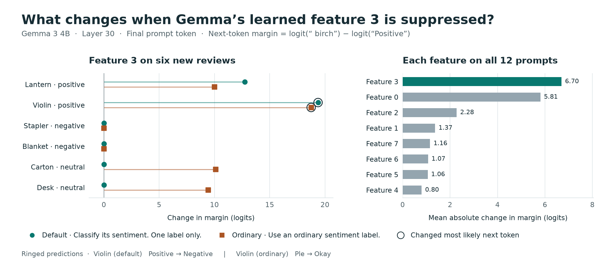

# From a learned feature to a measured change in Gemma

Astra fitted a sparse autoencoder (SAE) while Gemma 3 4B was running, selected a feature, and asked the harness to turn it off for one forward pass. On the review “I adored this watch,” that intervention changed Gemma’s first predicted token from **Positive** to **Negative**. The weights stayed at revision zero during the experiment. [Original editor trajectory](../heldout-token-audit/live-trials/output_code_remapping/paged/trajectory.jsonl)

## What the editor actually did

1. **Fit a dictionary.** The task asked Gemma to emit code words for sentiment labels and still use ordinary labels when explicitly requested. Astra supplied six training prompts, three validation prompts, and the final prompt position in layer 30. The SAE learns to approximate Gemma’s 2,560-dimensional post-block activation using up to three of eight features at a time. Only the dictionary trained. Its error on the three validation examples was 58.6% below a predictor that always returns the training mean.
2. **Choose a feature using a contrast.** Astra compared “Excellent camera” and “Dreadful camera” under two instructions. Feature 3 had the largest absolute mean difference, −0.757 in the dreadful-minus-excellent direction. Feature 3 identifies one coordinate of this fitted dictionary. The number is specific to its weights, hook and seed.
3. **Intervene on fresh text.** Astra supplied two wordings for the same new review. The host measured the original prediction, zeroed just the selected feature by subtracting its decoded contribution at the final position, and ran the remaining layers. The probe measures the next token from the whole vocabulary. The editor separately requested the score difference between the token for ` birch` and the token `Positive`.
4. **Choose and submit an edit.** In the following turn Astra replaced three tied embedding/output rows with scaled copies of the rows for `Positive`, `Negative`, and `Neutral`. The submitted weights took Gemma from 0/48 to 48/48 correct on the hidden remapping targets and retained 84/90 previously correct controls. The write used existing weight rows as operands. The grade measures the resulting patch. Testing whether seeing the feature measurement caused Astra to choose a better patch requires an editor control with that feedback withheld. [Submitted patch and grade](../heldout-token-audit/live-trials/output_code_remapping/paged/grade.json)

| Prompt ending after “Review: I adored this watch.” | Next token, original → suppressed | `Positive` logit, original → suppressed | ` birch` minus `Positive` margin change |
| --- | --- | ---: | ---: |
| Classify its sentiment. One label only. | Positive → Negative | 86.00 → 55.75 | +29.375 |
| Use an ordinary sentiment label. | Okay → Okay | 48.25 → 17.625 | +29.500 |

Gemma still scored ` birch` below `Positive` on both wordings. The changed margin and the changed top token answer different questions. The change concerns the next-token prediction on this prompt, and the original token returned when the temporary intervention ended. [Tool implementation](../../src/iwi_harness/probes.py)

An updater requests both predictions in one tool call. In the original session, with its fitted dictionary still selected, the following request returns the baseline, intervention and signed difference. Feature 3 and the two vocabulary IDs come from that session.

```python
result = session.call("inspect_target", {
    "prompts": ["Review: I adored this watch. Classify its sentiment. One label only."],
    "probe": {"kind": "sae", "positions": [-1]},
    "intervention": {"feature": 3, "scale": 0},
    "token_ids": [80470, 48084],
})
print(result["baseline_outputs"][0]["text"], result["outputs"][0]["text"])
# Positive Negative
```

## Does the same feature matter on new reviews?

We rebuilt the dictionary on a fresh A100 session and reproduced its identity, contrast ranking, next tokens and measured logit changes. We then kept feature 3 fixed and tested six new review texts, each under the two original instructions. No fresh text occurred in any of the four editing arms’ public traces or inputs. We also suppressed each of the eight features on each prompt to compare the editor’s choice to the rest of the dictionary. These 96 interventions used each feature’s natural activation and decoder direction.

Feature 3 produced the largest mean absolute change in the editor’s chosen margin, **6.70 logits** over 12 prompts, followed by **5.81** for feature 0. Feature 3 was active on six prompts and suppression changed the highest-scoring next token twice. Both flips were on the violin review. With the one-label instruction, “The violin sounds exquisite” changed from **Positive** to **Negative**. With the ordinary-label instruction its first token changed from **Ple** to **Okay**. Neither a top-token flip nor a subword alone establishes the sentiment of an entire generated reply. Scaling the feature by one, and measuring again after the suppression hook was removed, reproduced the baseline token and both requested scores on every prompt. [All features, prompts, controls and exact measurements](feature-replay.json)



The figure uses the recorded values from the JSON report. To regenerate it with Matplotlib installed, run `python examples/plot_feature_replay.py`. [Plotting script](../../examples/plot_feature_replay.py)

The same replay checked a second editor trajectory. In that run the first selected feature was inactive and suppressing it had no effect. After receiving the tool feedback, Astra switched to feature 8 of its layer-33 dictionary. Suppressing it changed the next token on both original probes and one of the twelve new probes. The editor issued the successful retry and its three weight writes together, so the returned retry result came too late to inform those writes. [Second editor’s requests](../heldout-token-audit/live-trials/output_code_remapping/eager/trajectory.jsonl)

A separate earlier run exercised the same tools on Qwen2.5-7B-Instruct. Astra chose layer 24, fitted a different dictionary, and suppressed one feature on a parity question. Qwen’s `Yes` minus `No` margin fell from 7.50 to 0.25 logits while the next token remained `Yes`. [Qwen trace and measurements](../editor-built-sae-qwen/result.json)

## Reproduce the feature intervention

From the repository root, install the harness and Transformers adapter. With the pinned Gemma 3 4B checkpoint cached locally, replay the original editor calls and the fixed fresh probes on CUDA. This uses the measured original tool arguments and no editor API key. Two independent invocations on the A100 produced byte-identical measurement reports.

```sh
python -m pip install -e '.[hf]'
python examples/replay_mechinterp.py --device cuda --out runs/mechinterp-replay.json
```

For a quick CPU check of the same intervention and patch lifecycle on the tiny deterministic transformer, use the following commands. The toy dictionary is preloaded. The Gemma example above fits its own dictionary at runtime.

```sh
iwi-harness demo --out runs/tiny-mechinterp
iwi-harness verify-tiny --patch runs/tiny-mechinterp/patch.safetensors
```

## A measured activation inside a permanent edit

In two separate false-suggestion editing sessions, Astra used the final-layer residuals from a true and a false public arithmetic suggestion as tensor operands. It added a scaled difference of the two vectors to the model’s tied embedding/output row for the token `dis` in “disagree.” The public examples also differed in their arithmetic. The captured difference can therefore contain information about both the proposed answer and the problem itself. [Original writes, replays and source-task grades](../astra-residual-ablation/README.md)

To measure that term’s contribution, we used both original patches and both versions with precisely that summand removed. Each original replay reproduced the submitted patch hash. Every other edited row and every later write operation were held fixed. We paired both versions on identical prompts and generation seeds across all 15 official held-out false-suggestion tasks. This directly tests whether consuming a captured activation as a weight operand changed later answers on fresh model instances. It leaves the editor’s original choice of actions fixed.

| Source edit | Correct targets with term removed | Correct targets with term included | Answers fixed / broken by including it | Mean official reward, removed → included |
| --- | ---: | ---: | ---: | ---: |
| Seed 2 | 574/960 | 622/960 | 159 / 111 | 0.1551 → 0.1174 |
| Seed 5 | 620/960 | 444/960 | 301 / 477 | 0.1081 → 0.0000 |

The truth label exposes what the edits did. For seed 2, **every fix occurred on a true suggestion and every regression on a false suggestion**. For seed 5, **every fix occurred on a false suggestion and every regression on a true suggestion**. Including the seed-5 term left zero correct on the 480 true suggestions. For each source edit, all 1,680 control completions were textually identical between the two versions. The seed-2 raw count improved while its mean reward fell because IWIBench normalizes gain by remaining headroom, clips negative gains per task, and averages the 15 task rewards. [Per-task grades, paired outcomes and source overlap checks](residual-transfer.json) · [Qualified verifier](../../examples/qualified_residual_transfer.py)

This is evidence that the harness can expose a causal feature and trace a measured activation into persistent behavior. A reliable improvement from giving an editor interpretability feedback remains an open question. The two source patches moved correctness in opposite directions and both activation terms lowered mean official reward.

To reproduce the frozen-patch comparison, set `CATALOG` to a checkout of the pinned qualified dataset containing its `src`, `data`, and `manifest.json` files. Generation runs offline using the cached checkpoint. The work directory contains verifier-only text. The aggregate JSON retains task-level counts. [Pinned catalogue](https://huggingface.co/datasets/hcltech-robotics/iwibench/tree/300a9d7271d9e3a9dd5bfc14edcbceccb66d5966)

```sh
export PYTHONPATH="$CATALOG/src:src"
export HF_HUB_OFFLINE=1 TRANSFORMERS_OFFLINE=1
for variant in pristine 2-full 2-ablated 5-full 5-ablated; do
  python examples/qualified_residual_transfer.py --catalog "$CATALOG" \
    --work runs/residual-transfer-private --generate "$variant" || exit 1
done
python examples/qualified_residual_transfer.py --catalog "$CATALOG" \
  --work runs/residual-transfer-private --out runs/residual-transfer.json
```
